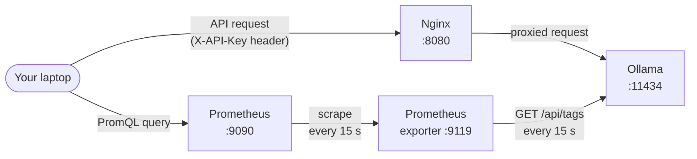
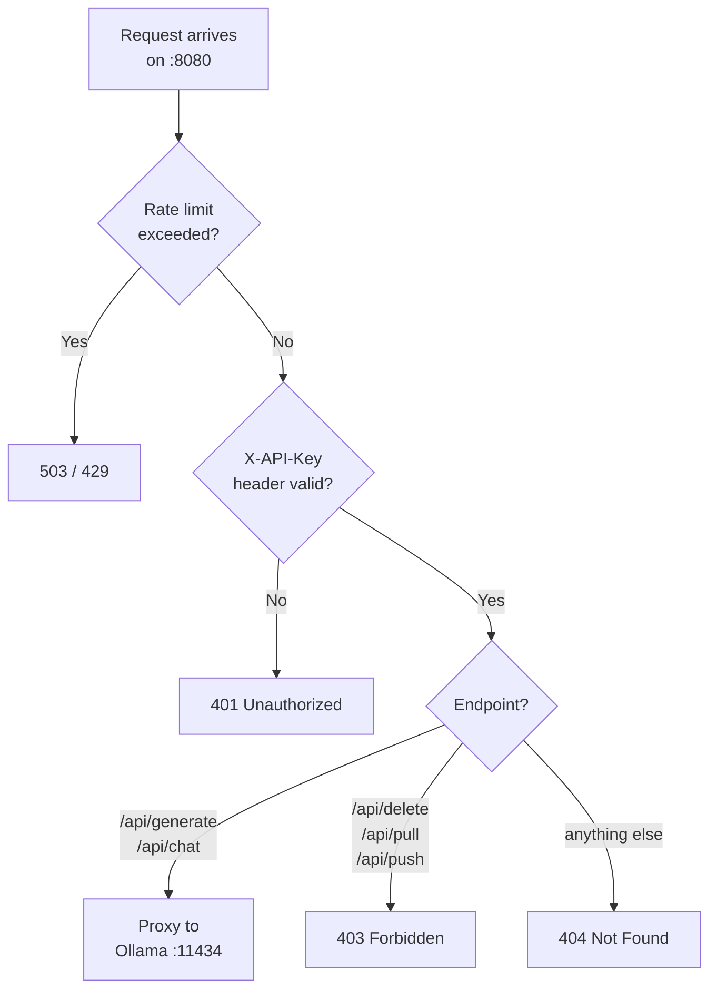
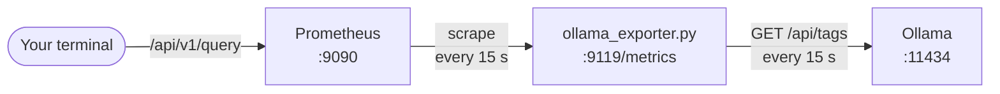

# IT LAB 14 - AI Inference Server Setup and Governance
{: .no_toc }

<details open markdown="block">
  <summary>Contents</summary>
  {: .text-delta }
1. TOC
{:toc}
</details>

---

## Objectives

By the end of this lab, given a provisioned Rocky Linux 9 VM with no AI
tooling installed, you will be able to:

- **Deploy** an Ollama inference server and manage multiple quantized models,
  producing a service that answers API calls and survives a restart (Part 1)
- **Evaluate** inference throughput and latency across three models and three
  prompt lengths, producing a structured results file and deriving comparative
  metrics from it (Part 2)
- **Apply** a reverse-proxy security layer in front of the Ollama API, verifying
  that rate limits and API-key enforcement behave as configured (Part 3)
- **Create** a custom Prometheus exporter for Ollama and confirm it is scraped
  by a local Prometheus instance installed on the same VM (Part 4)
- **Compose** a formal AI infrastructure governance policy with all eight required
  sections and rationale notes for every prohibited data type and control (Part 5)

---

## Tools Required

**VM:** Your instructor has provisioned a Rocky Linux 9 VM named `it-lab14-ai01`
(16 GB RAM, 4 vCPUs, 40 GB disk). Your username is your Net ID; your password was
emailed at the start of the semester.

**Starting conditions:** The VM is a fresh Rocky Linux 9 install. Ollama, Nginx,
Python packages (`requests`, `prometheus_client`), and firewall rules are not yet
configured. `git` and `curl` are present.

**Other tools used:**
- Ollama — installed during Part 1
- Python 3 with `requests` and `prometheus_client` — installed during Part 1
- Prometheus — installed during Part 4 (on this VM)
- `curl`, `jq`


**Estimated effort:** 3.5–4.5 hours (setup and verification ~1 h; benchmarking ~1 h;
Nginx + exporter + Prometheus ~1 h; governance policy ~45 min).

**Help route:** Post in #444` on the course Discord with: (1) the command
you ran, (2) the error message verbatim, (3) what you already tried. Response
expected within one business day; for urgent issues bring a laptop to office hours.

---

## Background

Organizations are increasingly deploying local AI inference servers to avoid sending sensitive data to external APIs (privacy), reduce costs (no per-token billing), and maintain control over model versions. IT engineers must treat AI inference infrastructure like any other production service: monitor it, gate access, enforce resource limits, and govern data handling.

Quantization reduces model size at the cost of some accuracy: a `Q4_K_M` quantized model uses ~4 bits per parameter vs. 16 bits for FP16, making it 4× smaller but slightly less accurate. For most business tasks, the accuracy tradeoff is acceptable.

Rocky Linux 9 ships with SELinux in enforcing mode and firewalld active. Both
interact with the services this lab configures: Nginx cannot proxy to localhost
without a boolean change, and ports must be explicitly opened in firewalld.
Treat these not as obstacles but as the normal security posture of a production
Linux server — the same controls you would manage on any RHEL-family host.

By the end of this lab you will have built the following infrastructure on a single VM:



Parts 1–2 set up Ollama. Part 3 adds the Nginx proxy. Part 4 adds the exporter and Prometheus. Part 5 governs the whole system.

**Submission directory:** Create this directory now and use it throughout the lab:

```bash
mkdir -p ~/lab14-submission
```

Each part ends with capture commands that write required files into this directory.
Run the capture commands after completing the part's setup steps.

---

## Procedure

### Part 1 - Ollama Deployment and Model Management

**Install prerequisites:**

Rocky Linux 9 does not include pip by default. Use `dnf` to install Python 3, pip, and `jq`. Then use `pip3` to install the `requests` and `prometheus_client` Python packages.

**Install Ollama:**

Install Ollama using the official one-line installer from ollama.ai:

```bash
curl -fsSL https://ollama.ai/install.sh | sh
```

**Pull models:**

Pull the following three models using `ollama pull`. Pulling all three will take several minutes depending on your connection speed.

- `llama3.2:1b` — small model (~1.3 GB), fast on CPU
- `llama3.2:3b` — medium model (~2.0 GB)
- `mistral:7b-instruct-q4_K_M` — larger quantized model (~4.1 GB)

**Configure Ollama for production use:**

Create the directory `/etc/systemd/system/ollama.service.d/` and write an `override.conf` file inside it. The file must configure the following environment variables with these exact values (the grader checks them):

| Variable | Required value | Purpose |
|---|---|---|
| `OLLAMA_HOST` | `0.0.0.0:11434` | Bind to all interfaces |
| `OLLAMA_MAX_LOADED_MODELS` | `2` | Limit concurrent loaded models |
| `OLLAMA_NUM_PARALLEL` | `4` | Allow parallel inference threads |
| `OLLAMA_KEEP_ALIVE` | `5m` | Unload idle models after 5 minutes |
| `OLLAMA_MAX_QUEUE` | `10` | Maximum queued requests |

The file also needs `LimitNOFILE=65536` under `[Service]`. Example structure:

```ini
[Service]
Environment="VARIABLE_NAME=value"
# ... one line per variable
LimitNOFILE=65536
```

After saving the file, reload the systemd daemon and restart Ollama.

Ollama binds to all interfaces but will only be reachable externally after the firewall port is opened in Part 3.

**Verification:** You should see the three model names and `active` before capturing:

```bash
curl -s http://localhost:11434/api/tags | jq '.models[].name'
sudo systemctl is-active ollama
```

If any model is missing, re-run its `ollama pull` command. If the service is not
active, check `journalctl -u ollama -n 30` before proceeding.

**Part 1 capture commands:**

```bash
ollama list > ~/lab14-submission/part1_models.txt
systemctl is-active ollama > ~/lab14-submission/part1_service.txt
systemctl show ollama --property=Environment > ~/lab14-submission/part1_override.txt
```

---

### Part 2 - Inference Benchmarking

Write a Python benchmarking script named `benchmark_inference.py`. Save it to your home directory and run it with `python3`. A reference implementation is provided below — read it, understand what each section does, then save and run it:

```python
#!/usr/bin/env python3
# Benchmark Ollama inference performance across models
import json
import time
import requests
import statistics

OLLAMA_URL = "http://localhost:11434"

MODELS = ["llama3.2:1b", "llama3.2:3b", "mistral:7b-instruct-q4_K_M"]
PROMPTS = [
    ("short", "What is DNS? Answer in one sentence."),
    ("medium", "Explain the difference between TCP and UDP in 3 paragraphs."),
    ("long", "Write a detailed explanation of how TLS 1.3 works, including the handshake process, key exchange, and cipher suites. Include specific differences from TLS 1.2."),
]

def benchmark_model(model, prompt_name, prompt, runs=3):
    times = []
    tokens = []
    for _ in range(runs):
        start = time.perf_counter()
        resp = requests.post(f"{OLLAMA_URL}/api/generate", json={
            "model": model,
            "prompt": prompt,
            "stream": False,
        }, timeout=300)
        elapsed = time.perf_counter() - start
        data = resp.json()
        times.append(elapsed)
        tokens.append(data.get("eval_count", 0))

    avg_time = statistics.mean(times)
    avg_tokens = statistics.mean(tokens)
    tok_per_sec = avg_tokens / avg_time if avg_time > 0 else 0

    return {
        "model": model,
        "prompt_type": prompt_name,
        "avg_latency_s": round(avg_time, 2),
        "avg_tokens": int(avg_tokens),
        "tokens_per_sec": round(tok_per_sec, 1),
    }

results = []
for model in MODELS:
    print(f"\nBenchmarking {model}...")
    for pname, prompt in PROMPTS:
        result = benchmark_model(model, pname, prompt)
        results.append(result)
        print(f"  {pname}: {result['tokens_per_sec']} tok/s, {result['avg_latency_s']}s latency")

# Print results table
print("\n\n=== BENCHMARK RESULTS ===")
print(f"{'Model':<40} {'Prompt':<10} {'Latency(s)':<12} {'Tok/s':<10}")
print("-" * 75)
for r in results:
    print(f"{r['model']:<40} {r['prompt_type']:<10} {r['avg_latency_s']:<12} {r['tokens_per_sec']:<10}")

with open("benchmark_results.json", "w") as f:
    json.dump(results, f, indent=2)
print("\nResults saved to benchmark_results.json")
```

**If a run times out:** The 7B model with the long prompt may approach the 300-second
timeout on a CPU-only server. If `requests.exceptions.Timeout` is raised, reduce
`runs=3` to `runs=1` for that model/prompt combination and re-run.

**Part 2 capture commands:**

```bash
cp benchmark_results.json ~/lab14-submission/

python3 << 'EOF' > ~/lab14-submission/part2_summary.json
import json, os

d = json.load(open(os.path.expanduser("~/lab14-submission/benchmark_results.json")))
short = {r["model"]: r["tokens_per_sec"] for r in d if r["prompt_type"] == "short"}
fastest = max(short, key=short.get)
ratio = round(short["llama3.2:1b"] / short["mistral:7b-instruct-q4_K_M"], 2)
candidates = {m: v for m, v in short.items() if "7b" not in m}
recommended = max(candidates, key=candidates.get)

import json as j
print(j.dumps({
    "ratio_1b_to_7b_short": ratio,
    "fastest_model_short_prompt": fastest,
    "recommended_model_5_concurrent_users": recommended
}, indent=2))
EOF
```

---

### Part 3 - API Gateway and Rate Limiting with Nginx

The Ollama API should not be directly exposed. Place an Nginx reverse proxy with rate limiting in front.

Every request to your proxy passes through the following checks in order:



**Setup steps:**

1. Install Nginx using `dnf`.
2. Rocky Linux 9 runs SELinux in enforcing mode. Set the `httpd_can_network_connect` boolean to allow Nginx to proxy to backend processes.
3. Open port 8080 in firewalld and reload the firewall rules.

**Choose an API key:**

Pick any string to use as your API key for this lab and export it as a shell variable. The capture commands use this variable so you do not need to hardcode the key anywhere else:

```bash
export API_KEY="your-key-here"
```

**Create `/etc/nginx/conf.d/ollama-proxy.conf`:**

Your config must implement the following requirements. The example below shows the structure — replace placeholder values with your own:

- An `upstream` block pointing to Ollama at `127.0.0.1:11434`
- Rate-limiting zones: 10 requests/minute per IP, max 5 concurrent connections per IP
- An `if` block that returns `401` when the `X-API-Key` header does not match your key
- A `location /api/generate` block that proxies to the upstream with a 300-second timeout and access logging
- A `location /api/chat` block that proxies to the upstream
- Blocks for `/api/delete`, `/api/pull`, and `/api/push` that return `403`
- A catch-all `location /` that returns `404`

```nginx
# Example — adapt values to your setup
upstream ollama_backend {
    server 127.0.0.1:11434;
    keepalive 32;
}

limit_req_zone $binary_remote_addr zone=your-zone-name:10m rate=10r/m;
limit_conn_zone $binary_remote_addr zone=your-conn-zone:10m;

server {
    listen 8080;
    server_name _;

    limit_req zone=your-zone-name burst=5 nodelay;
    limit_conn your-conn-zone 5;

    if ($http_x_api_key != "your-api-key-here") {
        return 401 "Unauthorized\n";
    }

    location /api/generate {
        proxy_pass http://ollama_backend;
        proxy_http_version 1.1;
        proxy_set_header Connection "";
        proxy_read_timeout 300s;
        proxy_send_timeout 300s;
        access_log /var/log/nginx/ollama_access.log combined;
    }

    location /api/chat {
        proxy_pass http://ollama_backend;
        proxy_http_version 1.1;
        proxy_set_header Connection "";
        proxy_read_timeout 300s;
    }

    location /api/delete  { return 403 "Forbidden\n"; }
    location /api/pull    { return 403 "Forbidden\n"; }
    location /api/push    { return 403 "Forbidden\n"; }

    location / { return 404 "Not Found\n"; }
}
```

Test the config with `nginx -t`, then enable and start Nginx, then reload it.

If the second or third test below returns 200 instead of 401/403, re-run
`nginx -t` and look for syntax errors before capturing.

**Part 3 capture commands:**

```bash
# Confirm API_KEY is set before running (run: export API_KEY="your-key-here")

# Test 1: valid key — expect HTTP 200
CODE1=$(curl -s -o /dev/null -w "%{http_code}" -X POST http://localhost:8080/api/generate \
    -H "X-API-Key: $API_KEY" \
    -H "Content-Type: application/json" \
    -d '{"model":"llama3.2:1b","prompt":"Hello","stream":false}')

# Test 2: wrong key — expect HTTP 401
CODE2=$(curl -s -o /dev/null -w "%{http_code}" http://localhost:8080/api/generate \
    -H "X-API-Key: wrong-key")

# Test 3: blocked endpoint — expect HTTP 403
CODE3=$(curl -s -o /dev/null -w "%{http_code}" http://localhost:8080/api/delete \
    -H "X-API-Key: $API_KEY")

jq -n \
    --argjson c1 "$CODE1" \
    --argjson c2 "$CODE2" \
    --argjson c3 "$CODE3" \
    '{"valid_key_status": $c1, "wrong_key_status": $c2, "blocked_endpoint_status": $c3}' \
    > ~/lab14-submission/part3_auth_test.json

# The Nginx directive that enforces per-request auth via subrequest (not using if)
echo "auth_request" > ~/lab14-submission/part3_auth_directive.txt
```

---

### Part 4 - Prometheus Metrics for AI Infrastructure

Part 4 builds the following metrics pipeline:



Write a Python script named `ollama_exporter.py` that exposes Ollama metrics to Prometheus. A reference implementation is provided — read it, then save it to your home directory:

```python
#!/usr/bin/env python3
# Simple Prometheus exporter for Ollama metrics
import time
import requests
from prometheus_client import start_http_server, Gauge, Counter

# Metrics
models_loaded = Gauge('ollama_models_loaded', 'Number of models currently loaded')
model_size_bytes = Gauge('ollama_model_size_bytes', 'Size of each model in bytes', ['model'])
inference_requests = Counter('ollama_inference_requests_total', 'Total inference requests', ['model', 'status'])

OLLAMA_URL = "http://localhost:11434"

def collect_metrics():
    try:
        resp = requests.get(f"{OLLAMA_URL}/api/tags", timeout=5)
        data = resp.json()
        models = data.get("models", [])
        models_loaded.set(len(models))
        for m in models:
            model_size_bytes.labels(model=m["name"]).set(m.get("size", 0))
    except Exception as e:
        print(f"Error collecting metrics: {e}")

if __name__ == "__main__":
    start_http_server(9119)
    print("Ollama exporter running on :9119")
    while True:
        collect_metrics()
        time.sleep(15)
```

**Start the exporter and open its port:**

1. Open port 9119 in firewalld so Prometheus can reach the exporter.
2. Run `ollama_exporter.py` in the background using `nohup`, redirecting output to a log file (e.g., `exporter.log`).

**Install Prometheus:**

1. Download the Prometheus binary for Linux/amd64 from the official GitHub releases page at `github.com/prometheus/prometheus/releases`. Version 2.53.0 or later is recommended.
2. Extract the archive and move the `prometheus` and `promtool` binaries to `/usr/local/bin/`.
3. Create the directories `/etc/prometheus` and `/var/lib/prometheus`.
4. Write a `prometheus.yml` config file to `/etc/prometheus/`. It needs a `global` block with a `scrape_interval` and a `scrape_configs` block with one job targeting `localhost:9119`. Example structure:

```yaml
# Example — adapt job name and target to your setup
global:
  scrape_interval: 15s

scrape_configs:
  - job_name: 'your-job-name'
    static_configs:
      - targets: ['host:port']
```

5. Write a systemd unit file at `/etc/systemd/system/prometheus.service`. It should run the `prometheus` binary with `--config.file` and `--storage.tsdb.path` flags and restart automatically on failure. Example structure:

```ini
# Example — replace paths with your actual installation paths
[Unit]
Description=Prometheus
After=network.target

[Service]
ExecStart=/path/to/prometheus \
  --config.file=/path/to/prometheus.yml \
  --storage.tsdb.path=/path/to/data
Restart=always

[Install]
WantedBy=multi-user.target
```

6. Reload systemd, enable and start the Prometheus service, then open port 9090 in firewalld.

**Verification checkpoint:** Wait 30 seconds for the first scrape, then confirm the target is up:

```bash
systemctl is-active prometheus
curl -s "http://localhost:9090/api/v1/query?query=up" | jq '.data.result[0].metric.job'
# Expected: "ollama"
```

If the target is not up, check `journalctl -u prometheus -n 20` and confirm the exporter is still running (`ps aux | grep ollama_exporter`).

**Part 4 capture commands:**

```bash
curl -s http://localhost:9119/metrics | grep ollama_ \
    > ~/lab14-submission/part4_metrics.txt

curl -s "http://localhost:9090/api/v1/query?query=ollama_model_size_bytes" \
    > ~/lab14-submission/part4_prom_query.json
```

---

### Part 5 - AI Infrastructure Governance Policy

Write your governance policy in `~/lab14-submission/policy.md`. The file must
satisfy the structural requirements listed at the end of this section — these
are checked automatically.

```
AI INFERENCE INFRASTRUCTURE GOVERNANCE POLICY
Policy ID: IT-AI-001
Version: 1.0
Owner: IT Operations
Effective Date: [Date]

1. PURPOSE
   This policy governs the deployment, operation, and use of self-hosted
   AI inference infrastructure within the organization.

2. SCOPE
   Applies to all self-hosted language model inference servers, including
   but not limited to Ollama, vLLM, llama.cpp, and similar platforms.

3. DATA CLASSIFICATION AND HANDLING
   3.1 PROHIBITED DATA: The following data types MUST NOT be submitted
       to AI inference endpoints:
         - PII (names, SSNs, addresses, dates of birth) — Rationale: [risk]
         - PHI (medical records, diagnoses, treatment information) — Rationale: [risk]
         - Authentication credentials (passwords, API keys, certificates) — Rationale: [risk]
         - Financial records (account numbers, payment card data) — Rationale: [risk]
         - Proprietary source code marked CONFIDENTIAL — Rationale: [risk]
         - [Add at least one more prohibited type] — Rationale: [risk]
   3.2 PERMITTED DATA: Anonymized operational data, publicly available
       information, and non-sensitive technical queries.

4. ACCESS CONTROLS
   4.1 All inference API access requires a valid API key issued by IT Operations.
       — Rationale: [risk]
   4.2 API keys are personal, non-shareable, and expire after 90 days.
       — Rationale: [risk]
   4.3 Rate limits: 100 requests/hour per key for standard users;
       500 requests/hour for approved automation workflows. — Rationale: [risk]

5. MODEL GOVERNANCE
   5.1 Only IT Operations-approved models may be deployed.
   5.2 Model pull requests require change management approval (Standard Change).
       Rationale: unlike a software package update, a new model version changes
       the system's behavior and output distribution in ways that cannot be
       verified by a checksum alone — [complete this rationale].
   5.3 Models must be reviewed for known biases and misuse potential.

6. MONITORING AND AUDIT
   6.1 All inference requests are logged (prompt hash, model, user, timestamp).
   6.2 Logs retained for 90 days.
   6.3 Anomalous usage patterns trigger security review.

7. INCIDENT RESPONSE
   7.1 Suspected prompt injection or misuse: report to security@[org] within 1 hour.
       — Rationale: [risk]
   7.2 Data exfiltration via AI endpoint: treat as P1 security incident.
       — Rationale: [risk]

8. REVIEW CYCLE
   This policy is reviewed annually and updated as AI infrastructure evolves.
```

**Structural requirements** (checked automatically):

| Requirement | Check |
|---|---|
| All 8 numbered sections present | Sections 1–8 each appear as a heading or numbered line |
| At least 6 prohibited data types | ≥ 6 lines matching `- ... — Rationale:` in section 3.1 |
| Rationale notes in sections 4 and 7 | ≥ 2 lines matching `— Rationale:` in each section |
| "prompt injection" appears in section 7 | Literal string present (case-insensitive) |
| Minimum length | `wc -w policy.md` ≥ 600 |

Replace every `[risk]` and `[complete this rationale]` placeholder with a specific, one-sentence explanation of the risk the control addresses.

---

## Self-Check

Run this script from `it-lab14-ai01` before submitting to verify your files pass
the automated checks:

```bash
#!/bin/bash
SUBDIR=~/lab14-submission
PASS=0; FAIL=0

check() {
    if eval "$2"; then echo "  PASS: $1"; ((PASS++));
    else echo "  FAIL: $1"; ((FAIL++)); fi
}

echo "=== Part 1 ==="
check "part1_models.txt contains llama3.2:1b" \
    "grep -q 'llama3.2:1b' $SUBDIR/part1_models.txt"
check "part1_models.txt contains mistral:7b" \
    "grep -q 'mistral' $SUBDIR/part1_models.txt"
check "part1_service.txt == active" \
    "grep -qx 'active' $SUBDIR/part1_service.txt"
check "part1_override.txt contains OLLAMA_MAX_LOADED_MODELS=2" \
    "grep -q 'OLLAMA_MAX_LOADED_MODELS=2' $SUBDIR/part1_override.txt"
check "part1_override.txt contains OLLAMA_NUM_PARALLEL=4" \
    "grep -q 'OLLAMA_NUM_PARALLEL=4' $SUBDIR/part1_override.txt"

echo "=== Part 2 ==="
check "benchmark_results.json is valid JSON with 9 entries" \
    "python3 -c \"import json; d=json.load(open('$SUBDIR/benchmark_results.json')); assert len(d)==9\""
check "benchmark_results.json all tokens_per_sec > 0" \
    "python3 -c \"import json; d=json.load(open('$SUBDIR/benchmark_results.json')); assert all(r['tokens_per_sec']>0 for r in d)\""
check "part2_summary.json is valid JSON" \
    "python3 -c \"import json; json.load(open('$SUBDIR/part2_summary.json'))\""
check "part2_summary.json ratio_1b_to_7b_short > 1.0" \
    "python3 -c \"import json; d=json.load(open('$SUBDIR/part2_summary.json')); assert d['ratio_1b_to_7b_short'] > 1.0\""

echo "=== Part 3 ==="
check "part3_auth_test.json valid_key_status == 200" \
    "python3 -c \"import json; d=json.load(open('$SUBDIR/part3_auth_test.json')); assert d['valid_key_status']==200\""
check "part3_auth_test.json wrong_key_status == 401" \
    "python3 -c \"import json; d=json.load(open('$SUBDIR/part3_auth_test.json')); assert d['wrong_key_status']==401\""
check "part3_auth_test.json blocked_endpoint_status == 403" \
    "python3 -c \"import json; d=json.load(open('$SUBDIR/part3_auth_test.json')); assert d['blocked_endpoint_status']==403\""
check "part3_auth_directive.txt contains auth_request" \
    "grep -qi 'auth_request' $SUBDIR/part3_auth_directive.txt"

echo "=== Part 4 ==="
check "part4_metrics.txt contains ollama_models_loaded" \
    "grep -q 'ollama_models_loaded' $SUBDIR/part4_metrics.txt"
check "part4_metrics.txt contains ollama_model_size_bytes" \
    "grep -q 'ollama_model_size_bytes' $SUBDIR/part4_metrics.txt"
check "part4_prom_query.json status == success" \
    "python3 -c \"import json; d=json.load(open('$SUBDIR/part4_prom_query.json')); assert d['status']=='success'\""
check "part4_prom_query.json has >= 3 results" \
    "python3 -c \"import json; d=json.load(open('$SUBDIR/part4_prom_query.json')); assert len(d['data']['result'])>=3\""

echo "=== Part 5 ==="
check "policy.md exists" \
    "test -f $SUBDIR/policy.md"
check "policy.md >= 600 words" \
    "test \$(wc -w < $SUBDIR/policy.md) -ge 600"
check "policy.md has all 8 sections" \
    "python3 -c \"
import re, sys
t = open('$SUBDIR/policy.md').read()
missing = [str(i) for i in range(1,9) if not re.search(rf'\b{i}\.', t)]
sys.exit(1 if missing else 0)
\""
check "policy.md >= 6 prohibited types with Rationale" \
    "test \$(grep -c '— Rationale:' $SUBDIR/policy.md) -ge 6"
check "policy.md contains 'prompt injection'" \
    "grep -qi 'prompt injection' $SUBDIR/policy.md"

echo ""
echo "Results: $PASS passed, $FAIL failed"
[ $FAIL -eq 0 ] && echo "Ready to submit." || echo "Fix failures before submitting."
```

---

## Submission

After all self-checks pass, package your submission:

```bash
cd ~
tar czf lab14-submission.tar.gz lab14-submission/
```

Upload `lab14-submission.tar.gz` to Learning Suite. Required files inside the archive:

| File | Contents |
|---|---|
| `part1_models.txt` | `ollama list` output |
| `part1_service.txt` | `systemctl is-active ollama` output |
| `part1_override.txt` | `systemctl show ollama --property=Environment` output |
| `benchmark_results.json` | 9-entry JSON from `benchmark_inference.py` |
| `part2_summary.json` | Derived benchmark metrics |
| `part3_auth_test.json` | 3 HTTP status codes as JSON |
| `part3_auth_directive.txt` | Nginx auth directive name |
| `part4_metrics.txt` | `curl localhost:9119/metrics \| grep ollama_` output |
| `part4_prom_query.json` | Prometheus API query result for `ollama_model_size_bytes` |
| `policy.md` | Governance policy document |

---

## Grading

| Item | Points | Automated check |
|---|---|---|
| `part1_models.txt` — all 3 models present | 5 | grep for each model name |
| `part1_service.txt` — value is `active` | 5 | exact match |
| `part1_override.txt` — `OLLAMA_MAX_LOADED_MODELS=2` and `OLLAMA_NUM_PARALLEL=4` | 5 | grep both strings |
| `benchmark_results.json` — valid JSON, 9 entries, all `tokens_per_sec > 0` | 10 | schema + value check |
| `part2_summary.json` — `ratio_1b_to_7b_short > 1.0` and consistent with benchmark data | 10 | value range + cross-check |
| `part3_auth_test.json` — status codes 200, 401, 403 | 15 | exact value match |
| `part3_auth_directive.txt` — contains `auth_request` | 10 | grep case-insensitive |
| `part4_metrics.txt` — contains `ollama_models_loaded` and `ollama_model_size_bytes` | 10 | grep both strings |
| `part4_prom_query.json` — `status == "success"`, ≥ 3 results with `model` labels | 5 | JSON field checks |
| `policy.md` — all 8 sections, ≥ 6 items with `— Rationale:`, "prompt injection" present | 15 | grep + wc |
| `policy.md` — ≥ 600 words | 10 | `wc -w` |
| **Total** | **100** | |


[← Back to Labs]({{ site.baseurl }}/labs/)
