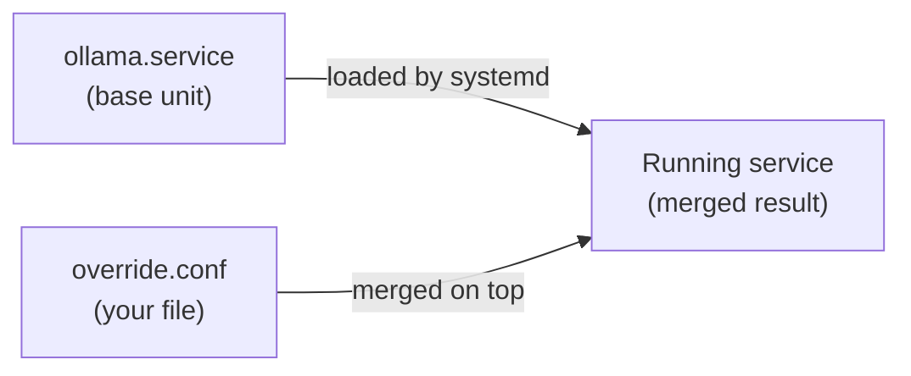

# Part 1 - Ollama Deployment and Model Management
{: .no_toc }

<details open markdown="block">
  <summary>Contents</summary>
  {: .text-delta }
1. TOC
{:toc}
</details>

---

{: .highlight }
> **Optional background (watch before starting):** [Run your own AI (but private)](https://www.youtube.com/watch?v=WxYC9-hBM_g) by NetworkChuck (~25 min) walks through Ollama installation and running local models step by step — close to what this part covers.

## Install Prerequisites

Rocky Linux 9 does not include pip by default. Use `dnf` to install Python 3, pip, and `jq`. Then use `pip3` to install the `requests` and `prometheus_client` Python packages.

## Install Ollama

Install Ollama using the official one-line installer from ollama.ai:

```bash
curl -fsSL https://ollama.ai/install.sh | sh
```

## Pull Models

Pull the following three models using `ollama pull`. Pulling all three will take several minutes depending on your connection speed.

- `llama3.2:1b` — small model (~1.3 GB), fast on CPU
- `llama3.2:3b` — medium model (~2.0 GB)
- `mistral:7b-instruct-q4_K_M` — larger quantized model (~4.1 GB)

## Configure Ollama for Production Use

Create the directory `/etc/systemd/system/ollama.service.d/` and write an `override.conf` file inside it. The file must configure the following environment variables with these exact values (the grader checks them):

{: .tip }
> **What is a systemd drop-in?** The drop-in directory holds files that *merge with* the base unit — they do not replace it. Any `[Service]` entries in `override.conf` are layered on top of the installer's unit. Run `systemctl daemon-reload` after any change; systemd reads all unit files at that point and does not detect changes automatically.

The directory structure looks like this:

```
/etc/systemd/system/
├── ollama.service          ← base unit (created by installer — do not edit)
└── ollama.service.d/       ← the directory you create
    └── override.conf       ← your additions
```



| Variable | Required value | Purpose |
|---|---|---|
| `OLLAMA_HOST` | `0.0.0.0:11434` | Bind to all interfaces |
| `OLLAMA_MAX_LOADED_MODELS` | `2` | Limit concurrent loaded models |
| `OLLAMA_NUM_PARALLEL` | `4` | Allow parallel inference threads |
| `OLLAMA_KEEP_ALIVE` | `5m` | Unload idle models after 5 minutes |
| `OLLAMA_MAX_QUEUE` | `10` | Maximum queued requests |

The file also needs `LimitNOFILE=65536` under `[Service]`. Example structure:

```ini
[Service]
Environment="VARIABLE_NAME=value"
# ... one line per variable
LimitNOFILE=65536
```

After saving the file, reload the systemd daemon and restart Ollama.

Ollama binds to all interfaces but will only be reachable externally after the firewall port is opened in Part 3.

## Verification

You should see the three model names and `active` before capturing:

```bash
curl -s http://localhost:11434/api/tags | jq '.models[].name'
sudo systemctl is-active ollama
```

If any model is missing, re-run its `ollama pull` command. If the service is not
active, check `journalctl -u ollama -n 30` before proceeding.

## Part 1 Capture Commands

```bash
ollama list > ~/lab14-submission/part1_models.txt
systemctl is-active ollama > ~/lab14-submission/part1_service.txt
systemctl show ollama --property=Environment > ~/lab14-submission/part1_override.txt
```

---

{: .highlight }
> **Before moving on — Part 1 complete when:**
> - The Ollama service is running and shows `active` when you check its status
> - All three models appear when you list installed models
> - Checking the running service's environment shows the override variables you set
> - The three capture files exist in `~/lab14-submission/` and are not empty

---

[← Prev: Overview](index) · [Next: Part 2 →](part2)

[← Back to Labs]({{ site.baseurl }}/labs/)
