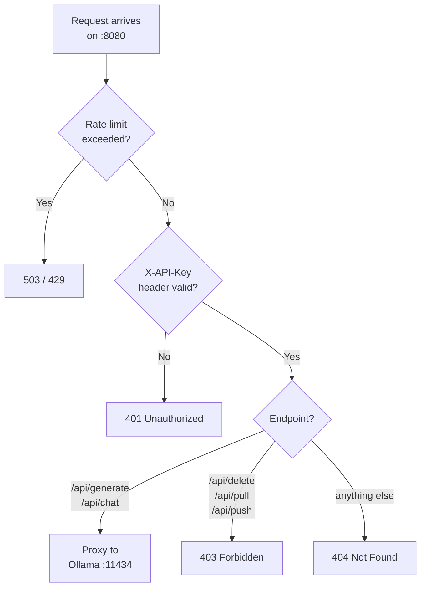

# Part 3 - API Gateway and Rate Limiting with Nginx
{: .no_toc }

<details open markdown="block">
  <summary>Contents</summary>
  {: .text-delta }
1. TOC
{:toc}
</details>

---

{: .highlight }
> **Optional background (watch before starting):** [Full NGINX Tutorial](https://www.youtube.com/watch?v=q8OleYuqntY) by TechWorld with Nana covers `upstream` blocks, `proxy_pass`, and `location` routing — the core Nginx concepts for this part.

The Ollama API should not be directly exposed. Place an Nginx reverse proxy with rate limiting in front.

Every request to your proxy passes through the following checks in order:



## Setup Steps

{: .important }
> **SELinux is enforcing.** Without the `httpd_can_network_connect` boolean set to `on`, Nginx will silently return a 502 Bad Gateway when it tries to proxy to Ollama — the config will look correct but all API requests will fail. This is the most common failure point in this part.

1. Install Nginx using `dnf`.
2. Rocky Linux 9 runs SELinux in enforcing mode. Set the `httpd_can_network_connect` boolean to allow Nginx to proxy to backend processes.
3. Open port 8080 in firewalld and reload the firewall rules.

{: .tip }
> **firewalld: `--permanent` vs. runtime.** `firewall-cmd --add-port=... --permanent` persists the rule across reboots but does *not* activate it in the running firewall immediately. You must also run `firewall-cmd --reload` for the rule to take effect now. If a port appears open after reboot but closed before, you are missing the `--reload`.

## Choose an API Key

Pick any string to use as your API key for this lab and export it as a shell variable. The capture commands use this variable so you do not need to hardcode the key anywhere else:

```bash
export API_KEY="your-key-here"
```

## Create `/etc/nginx/conf.d/ollama-proxy.conf`

Your config must implement the following requirements. The example below shows the structure — replace placeholder values with your own:

- An `upstream` block pointing to Ollama at `127.0.0.1:11434`
- Rate-limiting zones: 10 requests/minute per IP, max 5 concurrent connections per IP
- An `if` block that returns `401` when the `X-API-Key` header does not match your key
- A `location /api/generate` block that proxies to the upstream with a 300-second timeout and access logging
- A `location /api/chat` block that proxies to the upstream
- Blocks for `/api/delete`, `/api/pull`, and `/api/push` that return `403`
- A catch-all `location /` that returns `404`

```nginx
# Example — adapt values to your setup
upstream ollama_backend {
    server 127.0.0.1:11434;
    keepalive 32;
}

limit_req_zone $binary_remote_addr zone=your-zone-name:10m rate=10r/m;
limit_conn_zone $binary_remote_addr zone=your-conn-zone:10m;

server {
    listen 8080;
    server_name _;

    limit_req zone=your-zone-name burst=5 nodelay;
    limit_conn your-conn-zone 5;

    if ($http_x_api_key != "your-api-key-here") {
        return 401 "Unauthorized\n";
    }

    location /api/generate {
        proxy_pass http://ollama_backend;
        proxy_http_version 1.1;
        proxy_set_header Connection "";
        proxy_read_timeout 300s;
        proxy_send_timeout 300s;
        access_log /var/log/nginx/ollama_access.log combined;
    }

    location /api/chat {
        proxy_pass http://ollama_backend;
        proxy_http_version 1.1;
        proxy_set_header Connection "";
        proxy_read_timeout 300s;
    }

    location /api/delete  { return 403 "Forbidden\n"; }
    location /api/pull    { return 403 "Forbidden\n"; }
    location /api/push    { return 403 "Forbidden\n"; }

    location / { return 404 "Not Found\n"; }
}
```

{: .warning }
> **Nginx `if` is considered harmful.** The `if ($http_x_api_key != ...)` pattern works for this lab but is flagged in the official Nginx documentation as error-prone in `location` contexts. The more robust alternative is the `auth_request` directive, which delegates auth to a subrequest — it handles edge cases like CORS preflight that the `if` approach misses. The self-check script captures `auth_request` as the name of the preferred directive for exactly this reason.

Test the config with `nginx -t`, then enable and start Nginx, then reload it.

If the second or third test below returns 200 instead of 401/403, re-run
`nginx -t` and look for syntax errors before capturing.

## Part 3 Capture Commands

```bash
# Confirm API_KEY is set before running (run: export API_KEY="your-key-here")

# Test 1: valid key — expect HTTP 200
CODE1=$(curl -s -o /dev/null -w "%{http_code}" -X POST http://localhost:8080/api/generate \
    -H "X-API-Key: $API_KEY" \
    -H "Content-Type: application/json" \
    -d '{"model":"llama3.2:1b","prompt":"Hello","stream":false}')

# Test 2: wrong key — expect HTTP 401
CODE2=$(curl -s -o /dev/null -w "%{http_code}" http://localhost:8080/api/generate \
    -H "X-API-Key: wrong-key")

# Test 3: blocked endpoint — expect HTTP 403
CODE3=$(curl -s -o /dev/null -w "%{http_code}" http://localhost:8080/api/delete \
    -H "X-API-Key: $API_KEY")

jq -n \
    --argjson c1 "$CODE1" \
    --argjson c2 "$CODE2" \
    --argjson c3 "$CODE3" \
    '{"valid_key_status": $c1, "wrong_key_status": $c2, "blocked_endpoint_status": $c3}' \
    > ~/lab14-submission/part3_auth_test.json

# The Nginx directive that enforces per-request auth via subrequest (not using if)
echo "auth_request" > ~/lab14-submission/part3_auth_directive.txt
```

---

{: .highlight }
> **Before moving on — Part 3 complete when:**
> - Nginx is running and shows `active` when you check its status
> - Port 8080 is reachable from your terminal on the VM (e.g., `curl http://localhost:8080/`)
> - A request with your valid key to `/api/generate` returns HTTP 200
> - A request with a wrong key returns HTTP 401
> - A request to `/api/delete` with a valid key returns HTTP 403

---

[← Prev: Part 2](part2) · [Next: Part 4 →](part4)

[← Back to Labs]({{ site.baseurl }}/labs/)
