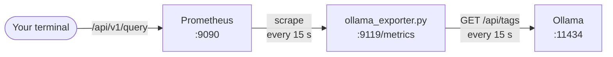
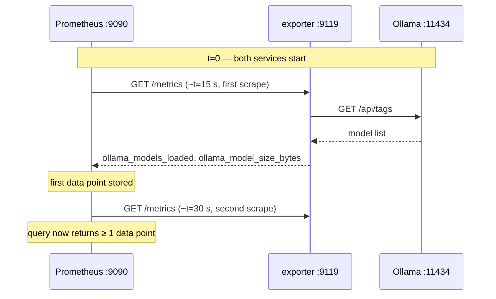

# Part 4 - Prometheus Metrics for AI Infrastructure
{: .no_toc }

<details open markdown="block">
  <summary>Contents</summary>
  {: .text-delta }
1. TOC
{:toc}
</details>

---

{: .highlight }
> **Optional background (watch before starting):** [How Prometheus Monitoring works](https://www.youtube.com/watch?v=h4Sl21AKiDg) by TechWorld with Nana covers the scrape architecture, jobs, targets, the `/metrics` endpoint format, and PromQL — all topics this part uses.

Part 4 builds the following metrics pipeline:



## Write the Prometheus Exporter

Write a Python script named `ollama_exporter.py` that exposes Ollama metrics to Prometheus. A reference implementation is provided — read it, then save it to your home directory:

```python
#!/usr/bin/env python3
# Simple Prometheus exporter for Ollama metrics
import time
import requests
from prometheus_client import start_http_server, Gauge, Counter

# Metrics
models_loaded = Gauge('ollama_models_loaded', 'Number of models currently loaded')
model_size_bytes = Gauge('ollama_model_size_bytes', 'Size of each model in bytes', ['model'])
inference_requests = Counter('ollama_inference_requests_total', 'Total inference requests', ['model', 'status'])

OLLAMA_URL = "http://localhost:11434"

def collect_metrics():
    try:
        resp = requests.get(f"{OLLAMA_URL}/api/tags", timeout=5)
        data = resp.json()
        models = data.get("models", [])
        models_loaded.set(len(models))
        for m in models:
            model_size_bytes.labels(model=m["name"]).set(m.get("size", 0))
    except Exception as e:
        print(f"Error collecting metrics: {e}")

if __name__ == "__main__":
    start_http_server(9119)
    print("Ollama exporter running on :9119")
    while True:
        collect_metrics()
        time.sleep(15)
```

## Start the Exporter and Open Its Port

1. Open port 9119 in firewalld so Prometheus can reach the exporter.
2. Run `ollama_exporter.py` in the background using `nohup`, redirecting output to a log file (e.g., `exporter.log`).

## Install Prometheus

1. Download the Prometheus binary for Linux/amd64 from the official GitHub releases page at `github.com/prometheus/prometheus/releases`. Version 2.53.0 or later is recommended.
2. Extract the archive and move the `prometheus` and `promtool` binaries to `/usr/local/bin/`. The tarball contains other files — only the two binaries are needed for this lab:

```
prometheus-2.53.0.linux-amd64/
├── prometheus              ← move this to /usr/local/bin/
├── promtool               ← move this to /usr/local/bin/
├── prometheus.yml          ← example config (you will write your own)
├── consoles/               ← not needed for this lab
└── console_libraries/      ← not needed for this lab
```

3. Create the directories `/etc/prometheus` and `/var/lib/prometheus`.
4. Write a `prometheus.yml` config file to `/etc/prometheus/`. It needs a `global` block with a `scrape_interval` and a `scrape_configs` block with one job targeting `localhost:9119`. Example structure:

```yaml
# Example — adapt job name and target to your setup
global:
  scrape_interval: 15s

scrape_configs:
  - job_name: 'your-job-name'
    static_configs:
      - targets: ['host:port']
```

5. Write a systemd unit file at `/etc/systemd/system/prometheus.service`. It should run the `prometheus` binary with `--config.file` and `--storage.tsdb.path` flags and restart automatically on failure. Example structure:

```ini
# Example — replace paths with your actual installation paths
[Unit]
Description=Prometheus
After=network.target

[Service]
ExecStart=/path/to/prometheus \
  --config.file=/path/to/prometheus.yml \
  --storage.tsdb.path=/path/to/data
Restart=always

[Install]
WantedBy=multi-user.target
```

6. Reload systemd, enable and start the Prometheus service, then open port 9090 in firewalld.

{: .tip }
> **Why wait 30 seconds?** Prometheus scrapes on its configured interval (15 s here). After both the exporter and Prometheus start, the first scrape completes at ~t=15 s and the second at ~t=30 s. PromQL queries require at least one stored data point; querying before the first scrape returns an empty result.



## Verification Checkpoint

Wait 30 seconds for the first scrape, then confirm the target is up:

```bash
systemctl is-active prometheus
curl -s "http://localhost:9090/api/v1/query?query=up" | jq '.data.result[0].metric.job'
# Expected: "ollama"
```

If the target is not up, check `journalctl -u prometheus -n 20` and confirm the exporter is still running (`ps aux | grep ollama_exporter`).

## Part 4 Capture Commands

```bash
curl -s http://localhost:9119/metrics | grep ollama_ \
    > ~/lab14-submission/part4_metrics.txt

curl -s "http://localhost:9090/api/v1/query?query=ollama_model_size_bytes" \
    > ~/lab14-submission/part4_prom_query.json
```

---

{: .highlight }
> **Before moving on — Part 4 complete when:**
> - The exporter process is running and not showing errors in its log file
> - Fetching the exporter's `/metrics` endpoint returns lines with `ollama_` metric names
> - The Prometheus target page shows your exporter job as "UP"
> - A PromQL query for `ollama_model_size_bytes` returns labeled results (one per model)

---

[← Prev: Part 3](part3) · [Next: Part 5 →](part5)

[← Back to Labs]({{ site.baseurl }}/labs/)
