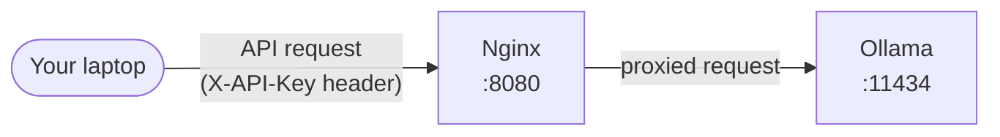

# IT LAB 14 - AI Inference Server Setup and Governance
{: .no_toc }

---

## Objectives

By the end of this lab, given a provisioned Rocky Linux 9 VM with no AI
tooling installed, you will be able to:

- **Deploy** an Ollama inference server and manage multiple quantized models,
  producing a service that answers API calls and survives a restart (Part 1)
- **Evaluate** inference throughput and latency across three models and three
  prompt lengths, producing a structured results file and deriving comparative
  metrics from it (Part 2)
- **Apply** a reverse-proxy security layer in front of the Ollama API, verifying
  that rate limits and API-key enforcement behave as configured (Part 3)
- **Compose** a formal AI infrastructure governance policy with all eight required
  sections and rationale notes for every prohibited data type and control (Part 4)

---

## Tools Required

**VM:** Your instructor has provisioned a Rocky Linux 9 VM named `it-lab14-ai01`
(16 GB RAM, 4 vCPUs, 40 GB disk). Your username is your Net ID; your password was
emailed at the start of the semester.

**Starting conditions:** The VM is a fresh Rocky Linux 9 install. Ollama, Nginx,
Python packages (`requests`, `prometheus_client`), and firewall rules are not yet
configured. `git` and `curl` are present.

**Other tools used:**
- Ollama - installed during Part 1
- Python 3 with `requests` - installed during Part 1
- `curl`, `jq`

**Estimated effort:** 2.5–3.5 hours (setup and verification ~1 h; benchmarking ~1 h;
Nginx ~45 min; governance policy ~45 min).

**Help route:** Post in `#444` on the course Discord with: (1) the command
you ran, (2) the error message verbatim, (3) what you already tried. Response
expected within one business day; for urgent issues bring a laptop to office hours.

---

## Background

Organizations are increasingly deploying local AI inference servers to avoid sending sensitive data to external APIs (privacy), reduce costs (no per-token billing), and maintain control over model versions. IT engineers must treat AI inference infrastructure like any other production service: monitor it, gate access, enforce resource limits, and govern data handling.

Quantization reduces model size at the cost of some accuracy: a `Q4_K_M` quantized model uses ~4 bits per parameter vs. 16 bits for FP16, making it 4× smaller but slightly less accurate. For most business tasks, the accuracy tradeoff is acceptable.

Rocky Linux 9 ships with SELinux in enforcing mode and firewalld active. Both
interact with the services this lab configures: Nginx cannot proxy to localhost
without a boolean change, and ports must be explicitly opened in firewalld.
Treat these not as obstacles but as the normal security posture of a production
Linux server - the same controls you would manage on any RHEL-family host.

By the end of this lab you will have built the following infrastructure on a single VM:



Parts 1–2 set up Ollama. Part 3 adds the Nginx proxy. Part 4 governs the whole system.

**Submission directory:** Create this directory now and use it throughout the lab:

```bash
mkdir -p ~/lab14-submission
```

Each part ends with capture commands that write required files into this directory.
Run the capture commands after completing the part's setup steps.

---

## Lab Navigation

| Part | Topic |
|---|---|
| [Part 1](part1) | Ollama Deployment and Model Management |
| [Part 2](part2) | Inference Benchmarking |
| [Part 3](part3) | API Gateway and Rate Limiting with Nginx |
| [Part 4](part4) | AI Infrastructure Governance Policy |
| [Self-Check & Grading](grading) | Verify your work and view the grading rubric |

---

[← Back to Labs]({{ site.baseurl }}/labs/)
